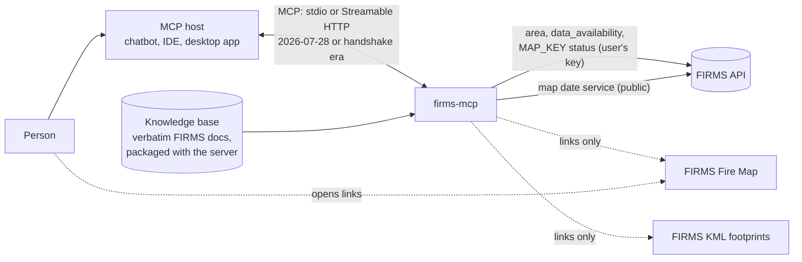
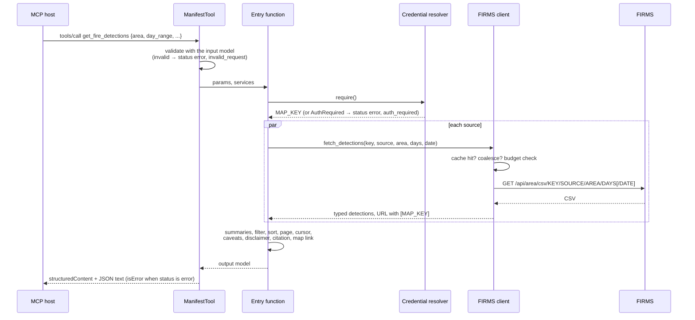

# Architecture

How the FIRMS MCP server is put together: its components, how a request flows through
them, where state lives, and where the planned authentication (WP8) and in-client map
(WP12) attach. Decisions are recorded in the [ADRs](../decisions/README.md); the MCP
surface is in the [tool catalog](TOOLS.md).

## Context

The server calls FIRMS only for detections, data availability, and key status. Map and
KML links are built locally and opened by the person, not fetched by the server. The
knowledge base ships inside the package, so knowledge tools work offline.

## Components

| Layer | Module | Responsibility | Design |
|---|---|---|---|
| Entry point | `firms_mcp.server` | `create_server`, operational routes, `create_http_app`, CLI (`firms-mcp [stdio\|http]`) | ADR-0002, ADR-0003 |
| MCP surface | `firms_mcp.tools.loader` | Discover tool directories, validate manifests, register `ManifestTool`s in name order | ADR-0002 |
| | `firms_mcp.tools.<name>/` | One tool: `manifest.json`, `models.py`, `tool.py` | [Tool catalog](TOOLS.md) |
| | `firms_mcp.tools.common` | Output base (`status`, errors), knowledge references, verbatim disclaimer and citation, areas, cursors | ADR-0007 |
| | `firms_mcp.resources`, `firms_mcp.prompts`, `firms_mcp.instructions` | Resources, prompts, server instructions | ADR-0005, ADR-0002 |
| Runtime | `firms_mcp.services` | One `Services` object per server: settings, knowledge base, FIRMS client, credential resolver, clock | — |
| | `firms_mcp.credentials` | Which MAP_KEY a request uses (local environment key; remote connected key or, if allowed, the operator key) | ADR-0004 |
| | `firms_mcp.config` | Settings from the environment and `.env` (secrets as `SecretStr`) | [Configuration](../developers/CONFIGURATION.md) |
| | `firms_mcp.logging_setup`, `firms_mcp.redaction` | JSON logs on stderr; MAP_KEY redaction everywhere | SEC-001 |
| Components (ARL2-M1) | `firms_mcp.knowledge` | Verbatim knowledge base: models, loader, search, sync | [Knowledge base](KNOWLEDGE_BASE.md) |
| | `firms_mcp.firms` | FIRMS client, source catalog, parsing and summaries, cache, budget, KML links | [FIRMS API client](FIRMS_API_CLIENT.md) |
| | `firms_mcp.maplinks` | Fire Map link builder and catalog snapshot | [Map links](MAP_LINKS.md) |
| | `firms_mcp.auth` *(WP8)* | Authorization server for the MAP_KEY connect flow, token encryption, step-up | ADR-0004 |

The components below the MCP surface do not depend on MCP; each was built and tested on
its own (ARL3-M1). The MCP layer composes them (ARL4-M1).

## A tool call

`ManifestTool` (a FastMCP `Tool` subclass) owns argument validation and error handling,
so every outcome — success, no results, invalid arguments, a FIRMS error, an unexpected
failure — reaches the model as a structured result with a remediation sentence. The
Earthdata MCP registers plain functions instead; the difference is recorded in the
[integration issues log](../project/INTEGRATION_ISSUES.md) (II-03).

## State

| State | Where | Lifetime | Notes |
|---|---|---|---|
| Knowledge base | Memory, loaded and validated at startup | Process | Invalid content stops the server |
| FIRMS responses | `ResponseCache` (TTL + LRU, single-flight) | 5 min NRT, 6 h SP | FIRMS data are public; a cached response can serve any user |
| Transaction estimates | `TransactionBudget`, per hashed key | Rolling 10 min | Per process; replicas keep separate windows |
| Pagination | The cursor itself (query + offset + first-page facts) | Client-held | No server-side session state (ADR-0003) |
| OAuth artifacts *(WP8)* | Pluggable key-value store | Minutes | Client registrations, codes, refresh rotation |

The MCP request path holds no per-session state, matching the stateless 2026-07-28
protocol; the same server also serves handshake-era sessions.

## Protocol eras and transports

FastMCP 4.1 negotiates per connection: 2026-07-28 clients use `server/discover` and
stateless requests; handshake-era clients (2025-11-25, 2025-06-18, …) use `initialize` and
`Mcp-Session-Id`. Both are tested in memory and over Streamable HTTP; stdio is tested by
starting the real `python -m firms_mcp` process
([tests/integration](../../tests/integration)).

| Transport | Command | Credential mode |
|---|---|---|
| stdio | `firms-mcp` (or `python -m firms_mcp`) | Local: `FIRMS_MAP_KEY` |
| Streamable HTTP | `firms-mcp http` → `http://127.0.0.1:8000/mcp` | Remote: connected key (WP8); the operator key only if `FIRMS_MCP_ALLOW_OPERATOR_KEY=true` |

HTTP routes: `/mcp` (MCP), `/health` (liveness and counts), `/.well-known/ard.json`
(agent discovery document, CORS `*`). FastMCP's host and origin protection applies to the
MCP endpoint.

## Errors, logging, and secrets

- FIRMS failures map to stable codes in `firms_mcp.firms.errors`; tools convert them to
  structured results. Unexpected exceptions are logged with a traceback and returned as
  `internal_error` without details.
- Logs are JSON lines on stderr (stdout is the stdio protocol channel), with the
  redacting filter on every handler; `httpx`/`httpcore` request logging is suppressed
  because FIRMS URLs contain the key.
- The MAP_KEY is never a tool parameter (SEC-002), never in results, links, logs, or error
  messages (SEC-001), and is registered for redaction as soon as it is resolved.

## Extension points

| To add | Do this | Guide |
|---|---|---|
| A tool | Create `src/firms_mcp/tools/<name>/` with `manifest.json`, `models.py`, `tool.py`; document it in the tool catalog | [Adding a tool](../developers/ADDING_A_TOOL.md) |
| Knowledge | Add Markdown entries to a configured knowledge directory | [Adding knowledge](../developers/ADDING_KNOWLEDGE.md) |
| A FIRMS source | Add it to `firms_mcp.firms.sources` (with map layers and knowledge entries) | [FIRMS API client](FIRMS_API_CLIENT.md) |

## Planned attachments

- **Authentication (WP8).** `create_http_app` accepts ASGI middleware. WP8 adds an
  `OAuthProvider` subclass (authorization-server routes, the connect page, encrypted
  tokens), a per-tool step-up middleware in front of `/mcp` that challenges calls to tools
  whose manifest says `require_auth` (using the `Mcp-Name` header on 2026-07-28 requests),
  and a credential resolver that reads the MAP_KEY from the verified token.
- **In-client map (WP12).** A `show_fire_map` tool declaring a `ui://` resource for MCP
  Apps hosts ([ADR-0009](../decisions/0009-interactive-map-via-mcp-apps.md)).
