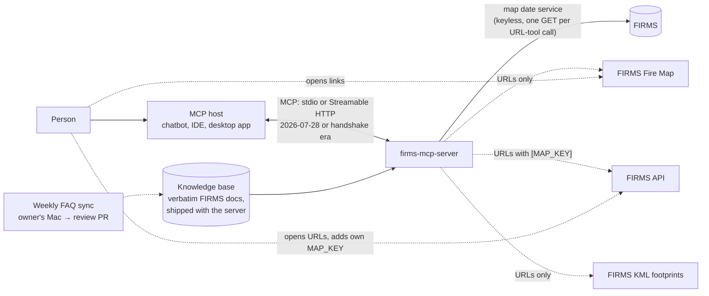

# Architecture

How the FIRMS MCP server (iteration 2, TypeScript) is put together: its components, how a
request flows through them, and where state lives. Decisions are in the
[ADRs](../decisions/README.md), chiefly
[ADR-0011](../decisions/0011-keyless-scope-typescript-rewrite-standard-data-first.md) (scope)
and [ADR-0012](../decisions/0012-typescript-project-layout-and-tool-contracts.md) (layout); the
MCP surface is in the [tool catalog](TOOLS.md). Iteration 1's Python architecture (detection
fetching, OAuth connect flow) is at tag `v0-iteration-1`.

## Context

The server holds no credentials and keeps no state between requests. Its only outbound
request is FIRMS's keyless map date service, used to choose standard or near real-time data;
if it fails, saved dates are used and the result says so. Everything else (knowledge, URL
building) works offline.

## Components

| Layer | Module | Responsibility | Design |
|---|---|---|---|
| Entry point | `src/index.ts` | `firms-mcp-server` (stdio) or `firms-mcp-server http` | ADR-0012 |
| Server | `src/server/create.ts` | New `McpServer` per stdio session or HTTP request; registers tools and resources | ADR-0011 §8 |
| | `src/server/http.ts` | Express app: stateless Streamable HTTP at `/mcp`, `/health`, Host/Origin checks | ADR-0012 §4 |
| | `src/server/instructions.ts` | Server instructions (safety, workflow, standard first, MAP_KEY, KML gating) | FR-MCP-009 |
| | `src/server/resources.ts` | `firms://knowledge/index`, `firms://knowledge/{entry_id}`, `firms://sources` | FR-KB-010 |
| Tools | `src/tools/<name>/tool.ts` | One `defineTool` per tool; Zod schemas are the contract | ADR-0012 §1 |
| | `src/tools/common.ts` | Shared schemas; knowledge base and missing-data table (loaded once); coverage per call | |
| Knowledge | `src/knowledge/` | Load and validate Markdown entries, BM25 search, completeness, missing-data table | [Knowledge base](KNOWLEDGE_BASE.md) |
| URL building | `src/sources/` | Source catalog (`sources.json`), coverage from the map date service, standard-first selection | [URL builders](URL_BUILDERS.md) |
| | `src/apiurls/` | Area API, `data_availability`, MAP_KEY status, KML, missing-data notes | [URL builders](URL_BUILDERS.md) |
| | `src/maplinks/` | Fire Map links and the layer catalog (`catalog.json`) | [Map links](MAP_LINKS.md) |
| | `src/common/` | Dates, boxes, `[MAP_KEY]` guidance, limitations statement, related links | |
| Contracts | `contracts/tools.json` | Generated from the Zod schemas; the target for a port to another stack | ADR-0012 §1 |
| Scripts | `scripts/ts/` | Contracts, traceability, smoke test, knowledge CLI and FAQ sync, map catalog check | |

## Request flow

1. The host calls a tool. The SDK validates the arguments against the tool's strict input
   schema; unknown arguments are rejected.
2. The tool's `run` builds its result. URL tools first ask the map date service for coverage
   (10-second timeout, snapshot fallback), then call a pure builder with the request,
   coverage, and today's UTC date.
3. `defineTool` validates the result against the output schema and returns it as structured
   content and as JSON text. A thrown error becomes an `isError` result whose message says
   what to change.

## State

| What | Where | Lifetime |
|---|---|---|
| Knowledge base, missing-data table, catalogs | Files shipped with the server; parsed once per process | Read-only |
| Coverage | Fetched per URL-tool call | One call |
| Sessions, users, keys | None | — |

## Quality

Tests, CI, and the requirement traceability are described in [Testing](../developers/TESTING.md).
Integration problems and their fixes are in the
[integration issues log](../project/INTEGRATION_ISSUES.md).
