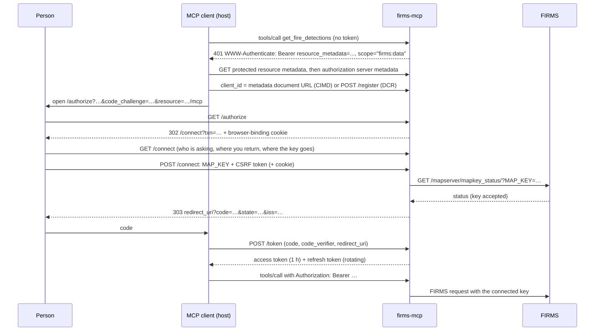

# Authentication

How users connect their FIRMS MAP_KEY, how the server protects it, and how to deploy the
connect flow. The decision is [ADR-0004](../decisions/0004-authentication-bring-your-own-map-key.md);
this document describes the implementation (`src/firms_mcp/auth/`, `src/firms_mcp/credentials.py`).
Requirements: FR-AUTH-001 … FR-AUTH-010 and SEC-001 … SEC-004 in
[requirements.yaml](../project/requirements.yaml).

## Modes

| Mode | When | Where the MAP_KEY comes from |
|---|---|---|
| Local | `firms-mcp` (stdio) | `FIRMS_MAP_KEY` in the environment or `.env` |
| Remote, OAuth | `firms-mcp http` with `FIRMS_MCP_AUTH=oauth` (default) | The key the user connects on the server's connect page, carried in their access token |
| Remote, no OAuth | `firms-mcp http` with `FIRMS_MCP_AUTH=none` (private deployments) | Only the operator key, if `FIRMS_MCP_ALLOW_OPERATOR_KEY=true` |

In remote mode the operator's `FIRMS_MAP_KEY` is never used unless
`FIRMS_MCP_ALLOW_OPERATOR_KEY=true` (owner decision OD-04), and even then only for anonymous
calls: a connected user's own key always wins (FR-AUTH-010).

Tools that do not need FIRMS data (knowledge, source catalog, data availability through
the public date service, map and KML links) work without any authentication
(FR-AUTH-002). `get_fire_detections` and `get_map_key_status` need a key.

## Endpoints

| Path | Purpose | Standard |
|---|---|---|
| `/.well-known/oauth-protected-resource/mcp` | Protected resource metadata: resource `<public URL>/mcp`, this server as authorization server, scope `firms:data` | RFC 9728 |
| `/.well-known/oauth-authorization-server` | Authorization server metadata, including `client_id_metadata_document_supported` and `authorization_response_iss_parameter_supported` | RFC 8414, RFC 9207 |
| `/register` | Dynamic Client Registration (compatibility; `FIRMS_MCP_ENABLE_DCR`) | RFC 7591 |
| `/authorize` | Authorization request: client, redirect URI, scope, PKCE S256, `resource` | OAuth 2.1, RFC 7636, RFC 8707 |
| `/connect` | The connect page (GET) and its form (POST) | — |
| `/token` | Code and refresh-token grants | OAuth 2.1 |
| `/revoke` | Revocation, including for public clients | RFC 7009 |

## The flow

## Clients

- **Client ID Metadata Documents (preferred).** A client whose `client_id` is an HTTPS URL
  is resolved by fetching that document (FastMCP's `CIMDClientManager`, with SSRF
  protection and caching). Its redirect URI must match the document. The connect page
  shows such clients as verified, with the document's host.
- **Dynamic Client Registration (compatibility).** Registrations are stored for 90 days.
  Redirect URIs must be `https`, `http` on a loopback address (RFC 8252), or an app's own
  scheme; `javascript:`, `data:`, `file:` and URIs with fragments are refused. The connect
  page marks these clients' names as supplied by the app itself.
- A registered (DCR) client's redirect URI must match one of its registered URIs exactly; a
  CIMD client's must match its document's `redirect_uris`, which may use loopback-port
  patterns. An unregistered redirect URI is never followed: the error is shown to the user
  instead (SEC-003).

## The connect page

- One self-contained page: no scripts, no third-party resources, styles pinned by hash in
  the Content-Security-Policy, `frame-ancestors 'none'`, `X-Frame-Options: DENY`,
  `Referrer-Policy: no-referrer`, `Cache-Control: no-store`. `form-action` allows the page's
  own origin and the client's redirect origin, because browsers apply it to the redirect
  that follows the form.
- It says which app is asking and where the user will be returned, that the key goes only
  to FIRMS and never to the AI model, where to request a free key, and that the service is
  not operated or endorsed by NASA.
- **Binding and CSRF (SEC-003).** `/authorize` sets an HttpOnly, SameSite=Lax cookie whose
  value is a keyed hash of the pending authorization's ID; the page and the form require
  it, so a connect link started by someone else cannot be completed in the victim's
  browser. The form also carries a random CSRF token stored with the pending
  authorization. Pending authorizations expire after 10 minutes and allow five attempts.
- **Checking the key (FR-AUTH-006).** The key must be 32 letters and digits, then FIRMS's
  MAP_KEY status service must accept it. A rejected key, a malformed key, or FIRMS being
  unreachable each produce a plain explanation on the page; an unverified key is never
  accepted. The user can also cancel, which returns `error=access_denied` to the client.
- Every authorization response — success or error — carries `iss` (RFC 9207).

## Tokens

- **Format (FR-AUTH-008).** JWE compact serialization, `alg: dir`, `enc: A256GCM`, with a
  `kid` and a `typ` (`at+jwe` access, `rt+jwe` refresh, `code+jwe` for the key held with a
  pending code). Claims: `iss`, `aud` (the resource `<public URL>/mcp`), `client_id`,
  `scope`, `iat`, `exp`, `jti`, `sub` (a keyed hash of the MAP_KEY, so the key is not
  revealed by the subject), and the MAP_KEY. Refresh tokens add a family ID (`fid`).
- **Verification.** A token is accepted only if it decrypts with a configured key, has the
  expected type, names this server as issuer and this resource as audience, and has not
  expired. Tokens from other issuers, for other audiences, encrypted with other keys, or
  of the wrong type are rejected (SEC-004). Verification needs no store: the MCP request
  path is stateless.
- **Lifetimes.** Access tokens one hour (`FIRMS_MCP_ACCESS_TOKEN_TTL`); refresh tokens 30
  days (`FIRMS_MCP_REFRESH_TOKEN_TTL`); codes five minutes and single use.
- **Rotation and replay (FR-AUTH-009).** Each refresh returns a new refresh token in the
  same family and records the used token's ID. Presenting a used refresh token again is
  treated as theft: the whole family is revoked, including the newest token.
- **Revocation.** Revoking a refresh token revokes its family. Access tokens cannot be
  revoked before they expire (they are stateless); this is why they are short-lived.
- **Keys.** `FIRMS_MCP_TOKEN_KEYS` holds comma-separated `kid:key` entries (32 random
  bytes, base64url). The first entry encrypts and all entries decrypt. Generate an entry
  with `firms-mcp keygen`. To rotate, put a new entry first, keep the old one for the
  refresh-token lifetime, then remove it. Without the variable the server uses a temporary
  key and logs a warning: users must reconnect after every restart.

## Step-up (FR-AUTH-003)

`StepUpAuth` runs before the MCP transport. A call to a tool whose manifest sets
`require_auth` without a valid token gets `401` with
`WWW-Authenticate: Bearer resource_metadata="…", scope="firms:data"` (no `error` attribute
when no token was sent, `error="invalid_token"` when one was), or `403 insufficient_scope`
when the token lacks the scope. Calls to other tools pass through anonymously.

The called tool is read from the `Mcp-Name` header on 2026-07-28 requests — the MCP SDK
rejects any request whose headers disagree with its body, which a test checks — and from
the JSON-RPC body (single message or batch) on handshake-era requests. The tools enforce
the key again themselves (`auth_required` result) as defense in depth.

## Deployment

| Setting | Purpose |
|---|---|
| `FIRMS_MCP_PUBLIC_URL` | The public HTTPS base URL (issuer and resource). Required whenever clients reach the server through another host name, a proxy, or a container |
| `FIRMS_MCP_TOKEN_KEYS` | Token encryption keys (see above); the same value on every replica |
| `FIRMS_MCP_AUTH` | `oauth` (default) or `none` |
| `FIRMS_MCP_ENABLE_CIMD`, `FIRMS_MCP_ENABLE_DCR` | Client registration methods (both on by default) |
| `FIRMS_MCP_ACCESS_TOKEN_TTL`, `FIRMS_MCP_REFRESH_TOKEN_TTL` | Token lifetimes, seconds |
| `FIRMS_MCP_ALLOW_OPERATOR_KEY` | Serve anonymous detection requests with the operator's `FIRMS_MAP_KEY` (off) |

- Serve over HTTPS (the connect page handles a credential; its cookie is `Secure` when the
  public URL is HTTPS).
- Registrations, pending authorizations, codes, and rotation records are kept in memory by
  default. With several replicas, pass a shared store (any `py-key-value` `AsyncKeyValue`,
  for example Redis) to `create_auth_provider(services, store=…)`; otherwise each replica
  sees only its own registrations and codes.
- Resolving Client ID Metadata Documents requires outbound HTTPS from the server.

## Limitations and open questions

- Which hosts support CIMD, step-up after anonymous use, and the connect page in practice
  is still to be checked with real clients (running list LU-09).
- FIRMS's policy on third-party services handling users' MAP_KEYs is not yet known (LU-06);
  the local (stdio) mode does not depend on it.
- Access tokens remain valid until they expire even after revocation of their refresh
  token (at most one hour by default).
