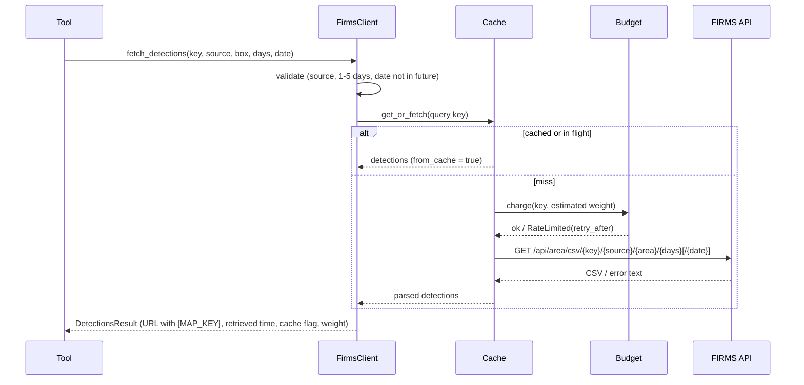

# FIRMS API Client — Design

Implements [ADR-0007](../decisions/0007-data-tool-design.md) below the tool layer.
Requirements: FR-DATA-001 … FR-DATA-004, FR-DATA-007 … FR-DATA-013, SEC-001.

## Modules (`src/firms_mcp/firms/`)

| Module | Responsibility |
|---|---|
| `sources.py` | Catalog of the eight FIRMS area-API sources: label, family, instrument, platforms, processing tier, nominal resolution, coverage, Fire Map layers, map-date key, KML sensor, record start per the FAQ, and the knowledge entries that explain each source |
| `geo.py` | `BoundingBox` (validated west < east, south < north; antimeridian boxes must be split), `world`, FIRMS area formatting, center/zoom helpers |
| `client.py` | `FirmsClient`: `fetch_detections`, `data_availability`, `map_key_status`, `map_dates`; retries, error mapping, caching, budget, key redaction |
| `detections.py` | `Detection` model; CSV parsing for every family; confidence classes and processing level; per-source `SourceSummary` |
| `budget.py` | FIRMS transaction-weight estimate and rolling 10-minute budget per key |
| `cache.py` | TTL + LRU response cache with single-flight request coalescing |
| `kml.py` | KML fire-footprint link builder (regions, periods, sensors; Landsat restrictions) |
| `errors.py` | Error classes with stable codes, remediation text, and retry hints |
| `../redaction.py` | MAP_KEY redaction for strings and log records; quiets `httpx`/`httpcore` request logging |

## Request flow

## Error mapping

| FIRMS response | Error code | Retried? |
|---|---|---|
| HTTP 400/401 whose text says the MAP_KEY is invalid | `invalid_map_key` | no |
| HTTP 403 ("MAP_KEY is invalid or your have exceeded your transaction/time limit") | `map_key_rejected` | no (retryable later) |
| HTTP 429 | `rate_limited` | no |
| Client-side budget would be exceeded | `rate_limited` with `retry_after_seconds` | no |
| Other HTTP 4xx, or HTTP 200 whose body starts with "Invalid" | `invalid_request` | no |
| HTTP 5xx, timeouts, connection errors | `upstream_unavailable` | yes, 2 retries with exponential backoff |
| Body is not the expected CSV/JSON | `upstream_format` | no |

## Decisions recorded here

- **Transaction weight** uses the formula FIRMS's own area-API page uses to display the
  cost of a request (`ceil(ceil(Δlon/60) · ceil(Δlat/60) · (2 VIIRS | 0.5 other) · days)`),
  so the guard and FIRMS agree on what "larger transactions" means as far as FIRMS
  publishes it. Live confirmation is running-list item LU-02.
- **Default budget 4,500** of FIRMS's 5,000 leaves headroom for other uses of the same key.
- **Cache is shared across users** because FIRMS data are public; this saves every user's
  quota. Cache keys never include the MAP_KEY.
- **Overpasses** in summaries are distinct (satellite, acquisition time) pairs computed from
  parsed UTC times, so `0942` and `942` are the same overpass.
- **Confidence classes** use the sensor's own documented vocabulary: MODIS thresholds from
  the MODIS C6/C6.1 user guide Table 11; VIIRS low/nominal/high; Landsat high/medium/low.
  The raw value is always kept.
- **`map_dates`** (undocumented, public) is used only for availability without a key; the
  documented `data_availability` endpoint is preferred when a key is present.
- **Logging:** constructing a `FirmsClient` installs log redaction and raises `httpx` and
  `httpcore` loggers to WARNING because they would otherwise print full URLs containing
  the key.
