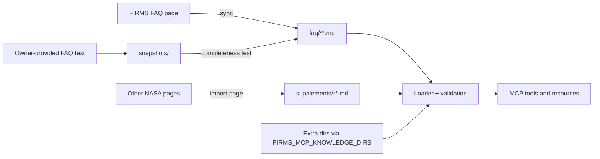

# Knowledge Base — Design

Implements [ADR-0005](../decisions/0005-knowledge-base-verbatim-and-extensible.md).
Requirements: FR-KB-001 … FR-KB-010 in [requirements.yaml](../project/requirements.yaml).

## Components

| Module | Responsibility |
|---|---|
| `firms_mcp/knowledge/models.py` | `KnowledgeEntry`, `KnowledgeSource`; `content_hash()` |
| `firms_mcp/knowledge/frontmatter.py` | Read and write Markdown with YAML front matter |
| `firms_mcp/knowledge/loader.py` | Locate directories, load and validate all entries (fail-fast with every problem listed), `KnowledgeBase` queries: `get`, `search`, `sections`, `ordered`, `suggestions` |
| `firms_mcp/knowledge/search.py` | Deterministic BM25 ranking with title and tag boosting and a small synonym table |
| `firms_mcp/knowledge/sync.py` | FAQ page → entries; generic page section → Markdown; writer with change report |
| `firms_mcp/knowledge/completeness.py` | Line-by-line verification of a reference text against the knowledge base |
| `firms_mcp/knowledge/__main__.py` | `validate`, `rehash`, `sync`, `import-page` commands |

## Content pipeline

## Conversion rules (HTML → Markdown)

The converter changes **form, never wording**:

| HTML | Markdown | Notes |
|---|---|---|
| `
` | paragraph | whitespace collapsed; non-breaking spaces become spaces |
| ` ` | hard break (`\` + newline); ` ` inside table cells | |
| `<a href>` | `[text](absolute URL)` | resolved against the page URL; `mailto:` kept |
| `<strong>`, `<em>` | `**…**`, `*…*` | |
| ``, `` | kept as inline HTML | footnote markers such as `Latency4` |
| `<ul>`, `<ol>` | `-` / `1.` lists, nested by indentation | |
| `<table>` | Markdown table | `|` in cells escaped |
| `<h3>`–`<h6>` | `###`–`######` | `<h2>` starts a new FAQ section |
| figure paragraph | `` and `*Image caption:* …` | screen-reader labels ("Image", "Image Caption") dropped |
| zero-width characters (U+200B etc.) | removed | invisible formatting artifacts found in the live page |

## Identifiers

- FAQ: `faq.<section>.<slug of question>`; section IDs are fixed for the 2026-10-09
  sections (`getting-started`, `support`, `caveats`, `viirs`, `modis`, `rt-urt`,
  `geostationary`, `landsat`, `hls`, `fire-map`, `swaths`, `email-alerts`, `us-canada`,
  `experimental`, `static-thermal-anomalies`, `acronyms`) and fall back to a slug of the
  heading for sections added later.
- Text directly under a section heading: `faq.<section>.overview` (`overview-2`, … if more).
- Supplements: `supplement.<section>.<name>`.

IDs are stable across refreshes as long as the question text is unchanged. If FIRMS
rewords a question, the old ID is retired and a new one added; the change report lists
both.

## Search

BM25 (k1 = 1.2, b = 0.75) over title × 3, tags × 2, and body; stopwords removed; simple
plural folding (not applied to words ending in -ss/-us/-is or to acronyms such as VIIRS);
a small, explicit synonym table expands lay terms ("how fast" → latency/updated, "dot" →
detection/pixel) at half weight. Ties break by page order. Results always carry the full
verbatim body; snippets are navigation aids only.

## Validation at load time

Missing or malformed front matter, unknown fields, invalid IDs, duplicate IDs, unknown
sources, broken `related` links, and body/hash mismatches are all collected and reported
together; the server refuses to start with invalid knowledge.

## Completeness guarantee

`tests/contract/test_faq_completeness.py` reduces both the owner-provided FAQ text and the
knowledge base to comparable plain text and requires every non-empty line of the reference
to be present (result on 2026-10-09: 0 missing lines). A negative control removes one
sentence and checks that the test notices.
