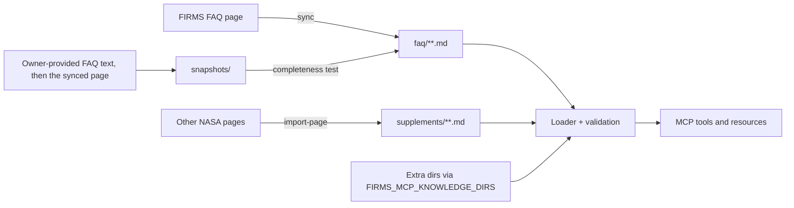

# Knowledge Base — Design

Implements [ADR-0005](../decisions/0005-knowledge-base-verbatim-and-extensible.md).
Requirements: FR-KB-001 … FR-KB-010 in [requirements.yaml](../project/requirements.yaml).

## Components

`src/knowledge/` is a port of iteration 1's Python modules (removed in WK-30; they remain at
tag `v0-iteration-1`), with the same entry schema, content hash, sort order, and search
ranking:

| Module | Responsibility |
|---|---|
| `src/knowledge/models.ts` | Entry and source schemas (Zod); `contentHash()` (same value as iteration 1's Python `content_hash`, since hashes are stored in the files) |
| `src/knowledge/frontmatter.ts` | Read and write Markdown with YAML front matter |
| `src/knowledge/loader.ts` | Locate directories (`knowledge/` plus `FIRMS_MCP_KNOWLEDGE_DIRS`), load and validate every entry with all problems listed, `KnowledgeBase` queries |
| `src/knowledge/search.ts` | The same BM25 ranking, synonyms, and snippets; `test/fixtures/search-parity.json` holds iteration 1's results for 26 queries and the tests require identical IDs, scores, and snippets |
| `src/knowledge/completeness.ts` | Line-by-line verification against the synced FAQ page (ADR-0013) |
| `src/knowledge/missing-data.ts` | FIRMS's missing-data table as saved by the sync (FR-KB-013) |
| `scripts/ts/knowledge.ts` | `validate`, `rehash`, `sync`, `missing-data`, `check`, `pr-body`, `import-page` |
| `scripts/ts/faq-sync/` | FAQ page → entries; change report; guard against implausible parses |

## Content pipeline

## Conversion rules (HTML → Markdown)

The converter changes **form, never wording**:

| HTML | Markdown | Notes |
|---|---|---|
| `
` | paragraph | whitespace collapsed; non-breaking spaces become spaces |
| ` ` | hard break (`\` + newline); ` ` inside table cells | |
| `<a href>` | `[text](absolute URL)` | resolved against the page URL; `mailto:` kept |
| `<strong>`, `<em>` | `**…**`, `*…*` | |
| ``, `` | kept as inline HTML | footnote markers such as `Latency4` |
| `<ul>`, `<ol>` | `-` / `1.` lists, nested by indentation | |
| `<table>` | Markdown table | `|` in cells escaped |
| `<h3>`–`<h6>` | `###`–`######` | `<h2>` starts a new FAQ section |
| figure paragraph | `` and `*Image caption:* …` | screen-reader labels ("Image", "Image Caption") dropped |
| zero-width characters (U+200B etc.) | removed | invisible formatting artifacts found in the live page |

## Identifiers

- FAQ: `faq.<section>.<slug of question>`; section IDs are fixed for the 2026-10-09
  sections (`getting-started`, `support`, `caveats`, `viirs`, `modis`, `rt-urt`,
  `geostationary`, `landsat`, `hls`, `fire-map`, `swaths`, `email-alerts`, `us-canada`,
  `experimental`, `static-thermal-anomalies`, `acronyms`) and fall back to a slug of the
  heading for sections added later.
- Text directly under a section heading: `faq.<section>.overview` (`overview-2`, … if more).
- Supplements: `supplement.<section>.<name>`.

IDs are stable across refreshes as long as the question text is unchanged. If FIRMS
rewords a question, the old ID is retired and a new one added; the change report lists
both.

## Search

BM25 (k1 = 1.2, b = 0.75) over title × 3, tags × 2, and body; stopwords removed; simple
plural folding (not applied to words ending in -ss/-us/-is or to acronyms such as VIIRS);
a small, explicit synonym table expands lay terms ("how fast" → latency/updated, "dot" →
detection/pixel) at half weight. Ties break by page order. Results always carry the full
verbatim body; snippets are navigation aids only.

## Validation at load time

Missing or malformed front matter, unknown fields, invalid IDs, duplicate IDs, unknown
sources, broken `related` links, and body/hash mismatches are all collected and reported
together; the server refuses to start with invalid knowledge.

## Completeness guarantee

The completeness test reduces a reference text and the knowledge base to comparable plain
text and requires every non-empty line of the reference to be present. A negative control
removes one sentence and checks that the test notices.

- **Until the first automated sync**, the reference is the owner-provided FAQ text of
  2026-10-09 (result: 0 missing lines).
- **From then on**, NASA's rewording makes that copy obsolete (the 2026-11-18 page no longer
  contains 17 of its lines), so the reference is the FAQ page the sync last parsed,
  `snapshots/firms-faq-page.html.gz`. Its text is read straight from the DOM — every
  paragraph, list item, table cell, heading, caption, and accordion question — without the
  Markdown converter, so a converter that lost text would be caught
  ([ADR-0013](../decisions/0013-faq-completeness-reference-follows-the-synced-page.md)).
- A separate test syncs the saved 2026-11-18 page into a copy of the knowledge base and
  requires all 1,015 of its lines, so the check is exercised on every run.

## Sync (TypeScript, iteration 2)

`scripts/ts/faq-sync/` is a port of the Python sync. On the 2026-11-18 page it writes files
byte-identical to the Python sync's (fixture `test/fixtures/faq-sync-parity.json`), and the
front-matter writer reproduces all existing entry files byte for byte. Additions in
iteration 2: a guard that refuses an implausible parse (FR-KB-012), a dry-run `check`, the
saved page snapshot, and the missing-data table (FR-KB-013).
